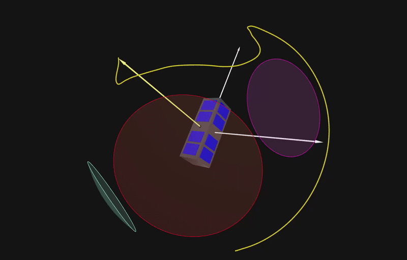
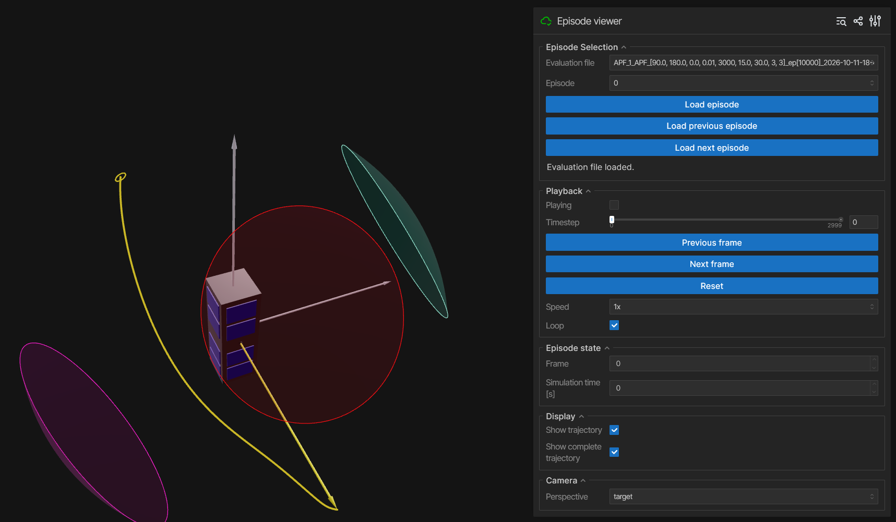

# Deep Reinforcement Learning for Spacecraft Reorientation Control with Multiple Pointing Keep-Out Zones



## Table of Contents
- [1. Introduction](#1-introduction)
- [2. Setup](#2-setup)
- [3. Overview](#3-overview)
- [4. How to Use](#4-how-to-use)

Contact: Cemal.Yilmaz@telematik-zentrum.de

## 1. Introduction
With this repository, an agent can be trained as a controller, supporting 0-3 KOZs in its current state. This project uses (spatial) LSTM to transform a varying number of KOZ states into a fixed-size observation. SAC is used as the DRL algorithm.

The repository comes with differend kinds of utility and QoL features to make training, evaluation, and visualization easier.

> [!NOTE]
Currently, only (3) reaction wheels are used as actuators. Adding more reaction wheels only requires minor changes. Using thrusters instead requires more changes (see examples on how to use thrusters with Basilisk).

## 2. Setup
The commands are for Windows.
1. Clone the repository.
    ````
    git clone https://github.com/Tanki777/drl-safe-sat-control
    ````
2. Change to the repository.
    ````
    cd drl-safe-sat-control
    ````
3. Create a virtual environment.
    ````
    python -m venv .venv
    ````
4. Activate the virtual environment.
    ````
    .\.venv\Scripts\Activate.ps1
    ````
5. Upgrade pip.
    ````
    python -m pip install --upgrade pip
    ````
6. Install dependencies.
    ````
    python -m pip install -r requirements.txt
    ````
7. **Optional**: by default, CPU is used as a device as it is faster than CUDA for this application. If you want to use CUDA anyway, install torch for your CUDA version. This command shows an example for CUDA cu128.
    ````
    python -m pip install torch torchvision torchaudio --index-url https://download.pytorch.org/whl/cu128
    ````

### 2.1. How to Use
Before training your first agent with this repository, it makes sense to get a basic understanding of the structure of this project and its components. If you want to skip this part, go to the final section on [how to use](#4-how-to-use).

## 3. Overview

### 3.1. Project Structure
Initially, your directory structure should look like this:
````
└───drl-safe-sat-control
    ├───APF_SMC
    ├───agent_simulation
    ├───agent_training
    ├───assets
    └───config
````
Create the folders which will be used to store models, evaluation data and other artifacts by running this script:
````
python init_folders.py
````
Afterwards, your directory structure should look like this:
````
├───drl-safe-sat-control
│   ├───APF_SMC
│   ├───agent_simulation
│   ├───agent_training
│   ├───assets
│   └───config
├───evaluation_data
├───models
├───models_meta
├───models_replay_buffers
├───monitor_logs
├───schedules
└───tensorboard
````

### 3.2. Agent Training
This section explains all important components inside the ``agent_training`` folder.

#### 3.2.1 Constants
``constants.py`` contains the satellite configuration (including reaction wheels) and timestep duration.

#### 3.2.2. Environment
``environment.py`` contains the custom gym environment for this project. It uses Basilisk for the dynamics. The reward function is also defined here and can be changed. Lastly, the LSTM is also implemented in this file.

#### 3.2.3. Trainer
``trainer.py`` is the backend for the auto trainer (see next subsection), which incorporates basic functionality regarding model creation / loading / saving, but also logging.

#### 3.2.4. Auto Trainer
``auto_trainer.py`` uses ``trainer.py`` to follow a training schedule and is the script which has to be executed when you want to train an agent.

#### 3.2.5. Tensorboard Server Standalone
``tensorboard_server_standalone.py`` can be executed separately to start the TensorBoard server without the need of having a training process running.

### 3.3. Agent Simulation
This section explains all important components of the ``agent_simulation`` folder.

#### 3.3.1. Env Simulator
``env_simulator.py`` simply allows you to test satellite dynamics and KOZ generation without any agent or controller.

#### 3.3.2 Evaluation
``evaluation.py`` contains all the functionality for evaluation (i.e. use a trained and saved model for inference to evaluate its performance).

#### 3.3.3. Visualization
``visualization.py`` provides matplotlib plots to show 3D trajectory and metric plots for e.g. attitude error, reward, torque, etc.

#### 3.3.4. 3D Visualization
``3d_visualization.py`` uses Viser to open a server, where you can easily load saved evaluation files and replay the episodes in the browser.

### 3.4. Config
This section explains all important components of the ``config`` folder.

``config.py`` is the adapter for user-configurable parameters.

``config.json`` is the config file, where you can modify various settings and parameters.

### 3.5. APF SMC Controller
For comparison, a potential field based APF SMC controller is implemented in ``APF_SMC``. This code is kindly provided by the original author of the corresponding paper: [Yang et al](https://arc.aiaa.org/doi/10.2514/1.G005026).

The code contains a minor modification to prevent program crashes due to NaN errors, see function ``Lf()`` in ``APF_SMC/apf_smc_controller.py``.

---
## 4. How to Use

### 4.1. Training

#### 4.1.1. Configuration
Before training, make sure you have configured everything.
- Satellite: If you dont want to use the default satellite, adjust its parameters in ``agent_training/constants.py``.
- Device: If you dont want to use the CPU, change ``general/DEVICE`` to ``"cuda"`` inside ``config/config.json``.
- SAC hyperparameters and LSTM output dimension: You can adjust them at ``general/`` inside ``config/config.json``.
- Model name: You must set a model name at ``training/MODEL_NAME`` inside ``config/config.json``.
- Schedule: You must set a training schedule. If you have not created any schedule yet, see [here](#412-schedule-creation).
- Continue training: You must set whether to start training a new agent, or continue training a saved agent. 

#### 4.1.2. Schedule Creation
A training schedule defines the settings used for training regarding curriculum learning phases, initial values, KOZ configurations.
Create a new .json file in the ``schedules`` folder and name it freely. Then, create its content, using the following as an example template:

````json
{
    "name": "schedule_1",
    "phases": [
        {
            "phase_name": "Test Phase 1: No KOZs",
            "timesteps": 100000,
            "min_initial_error_angle": 0.0,
            "max_initial_error_angle": 30.0,
            "min_initial_angular_velocity": 0.0,
            "max_initial_angular_velocity": 0.1,
            "max_steps": 3000,
            "min_half_angle_koz": 0.0,
            "max_half_angle_koz": 0.0,
            "min_nr_koz": 0,
            "max_nr_koz": 0,
            "margin_koz": 0.0
        },
        {
            "phase_name": "Test Phase 1: 1 KOZ",
            "timesteps": 200000,
            "min_initial_error_angle": 0.0,
            "max_initial_error_angle": 180.0,
            "min_initial_angular_velocity": 0.0,
            "max_initial_angular_velocity": 0.1,
            "max_steps": 3000,
            "min_half_angle_koz": 15.0,
            "max_half_angle_koz": 30.0,
            "min_nr_koz": 1,
            "max_nr_koz": 1,
            "margin_koz": 0.0
        },
        {
            "phase_name": "Test Phase 2: 0-3 KOZs",
            "timesteps": 400000,
            "min_initial_error_angle": 80.0,
            "max_initial_error_angle": 180.0,
            "min_initial_angular_velocity": 0.0,
            "max_initial_angular_velocity": 0.1,
            "max_steps": 3000,
            "min_half_angle_koz": 15.0,
            "max_half_angle_koz": 30.0,
            "min_nr_koz": 0,
            "max_nr_koz": 3,
            "margin_koz": 20.0
        }
    ]
}
````
- ``name``: The schedule name.
- ``phase_name``: The phase name.
- ``timesteps``: The number of timesteps to train this phase. E.g. in the example, the first phase is trained for 100k steps, the second phase is then trained for another 200k steps and so on.
- ``min_initial_error_angle / max_initial_error_angle``: The minimum / maximum initial attitude error angle in **degree**.
- ``min_initial_angular_velocity / max_initial_angular_velocity``: The minimum / maximum initial angular velocity (satellite) in **deg / s**.
- ``max_steps``: The maximum timesteps of one episode. By default, the episode is always as long as configured here.
- ``min_half_angle_koz / max_half_angle_koz``: The minimum / maximum half angle of the KOZ in **degree**.
- ``min_nr_koz / max_nr_koz``: The minimum / maximum number of KOZs.
- ``margin_koz``: The **minimum** margin angle between the center zone and its left / right neighboring zone in **degree**. For example, 10° results in a random margin between 10° and 10°+$\theta$, where $\theta$ is the sampled KOZ half angle. Setting this value to 0° makes it possible for zones to touch each other (their borders), and a negative value enables overlapping zones.

>[!NOTE]
By default, early termination is not used. But it can be activated to incorporate reward functions which use early termination.

#### 4.1.3. Start Training
After everything is configured, training can be started or continued by running:
````
python agent_training/auto_trainer.py
````

1. Training a **new** model: The command above can simply be executed.
2. **Continue** training a saved model: Some additional steps must be taken before running the script. Besides setting ``training/CONTINUE_TRAINING`` to ``true``, the steps are different depending on continuing a model which **fully** completed its schedule or you want to continue training from a specific **checkpoint**:
    - Continuing a fully completed model:
        1. Edit the model meta file at ``models_meta/<my_model_name>.json``. At the bottom, there are all schedule phases listed. The value of the last phase's ``timesteps_left`` is ``0``. Change it to the number of timesteps you want to continue training for.
        2. Run the command above.
    - Continuing from a checkpoint:
        1. Create a new folder in the ``models`` and ``models_replay_buffers`` folders and name it in both cases like the new model name.
        2. Copy the checkpoint model and vecnormalize files from ``models`` (e.g. ``models/<my_old_model_name>/<my_old_model_name>_300000.zip`` and ``models/<my_old_model_name>/<my_old_model_name>_300000_vecnormalize.pkl``) and paste them to the new folder in ``models``.
        3. Rename those two files, such that the model name within the file name equals the new model name. Also replace the timestep number (e.g. ``300000``) with ``latest``, as the auto trainer will always load the files marked as ``latest`` for continuation.
        4. Copy the checkpoint model replay buffer file from ``models_replay_buffers`` (e.g. ``models_replay_buffers/<my_old_model_name>/<my_old_model_name>_300000.pkl``) and paste it to the new folder in ``models_replay_buffers``.
        5. Rename that file, similar to the other files before: Adjust the model name of the file and replace the timestep number with ``latest``.
        6. Copy the model meta file of the old model from ``models_meta`` into the same ``models_meta`` folder and rename the file accordingly. Also, edit the new meta file and update ``model_name``. Edit the remaining timestep values for the phases according to how you want to continue training.
        7. Make sure that ``training/MODEL_NAME`` and ``training/SCHEDULE_FILE_NAME`` in ``config/config.json`` are set to the new model / schedule name.
        8. Run the command above.

> [!CAUTION]
If you want to continue training with a **different** schedule, also update ``schedule_name`` and the phases listed at the bottom at **step f**. The phases listed in the meta file must then match the phases of the new schedule file.

#### 4.1.4. Monitor Training
There are two methods available to monitor training progress. The first uses SB3's built in monitor wrapper, which creates a folder for the model in ``monitor_logs``. The model folder then creates a csv file for as many environments are used (by default 8). Each csv file contains these metrics:

- ``r``: Episode reward.
- ``l``: Episode length.
- ``t``: Wall-clock time [s].
- ``initial_error_angle``: The initial attitude error angle [deg].
- ``initial_angular_velocity``: The initial satellite angular velocity [deg/s].
- ``final_error_angle``: The attitude error angle at the end of episode [deg].
- ``settling_time``: The settling time [s] (if settled within configured settling threshold (``final_error_angle == 1°``) by default).
- ``min_margin_koz``: The closest / deepest the boresight vector got to / into a KOZ within the episode.
- ``entered_koz_count``: The amount of timesteps a KOZ is violated within the episode.

> [!NOTE]
If there is no active KOZ, ``min_margin_koz`` shows up as 180° as this value is being used for non-active KOZ states.

Additionally, more metrics are logged into ``tensorboard`` for each model. When starting training, a TensorBoard server is also started at http://localhost:6006. It shows default metrics, such as mean eipsode reward, entropy coefficient, actor- / critic loss etc. But, it also shows many custom metrics. In addition to the metrics in the csv file, there is average torque and whether or not it settled. Since TensorBoard combines all (eight) environment data, one data point shows either the minimum, mean, or maximum of these values. Which one is used, is hinted by the metric name suffix. Regarding the LSTM, all weights and biases are logged as well (which results in many charts depending on the LSTM size).

#### 4.1.5. Regular Saving
By default, a model (including the replay buffer) is saved every 100k timesteps. Depending on the task complexity and especially the SAC hyperparameter ``gradient_steps``, hundreds of checkpoints accumulate. The size of the replay buffer file is by far the most relevant one (200 MB+). 

Depending on the training schedule design and the model performance, it might be necessary to continue training a model from a checkpoint which is not the end of a training phase. In that case, saving the replay buffer as often as the model is recommended and the default behavior. Regularly deleting unused replay buffer files therefore is advised.

However, one can instead only save the replay buffer at the end of a phase, by commenting the following line in ``trainer.py`` (``save_model()``):

````
model.save_replay_buffer(backup_path_replay)
````

### 4.2. Evaluation
To evaluate a trained model, it can be evaluated by simulating a number of episodes.

#### 4.2.1. Configuration
In ``config.json`` under ``evaluation``, configure the model and simulation settings:

- ``CONTROLLER``: Whether to use a trained model (``"DRL"``) or the APF controller (``"APF"``) for comparison. 
- ``MODEL_NAME``: The name of the model. In case of APF, an arbitrary name can be set (which will be used to save the evaluation data).
- ``TIMESTEP``: Which checkpoint timestep to use from the saved model files. In case of APF, arbitrary number can be set.
- ``MAX_STEPS``: Episode length.
- ``MIN_INITIAL_ERROR_ANGLE / MAX_INITIAL_ERROR_ANGLE``: Initial attitude error angle range [deg].
- ``MIN_INITIAL_ANGULAR_VELOCITY / MAX_INITIAL_ANGULAR_VELOCITY``: Initial satellite angular velocity range [deg/s].
- ``MIN_HALF_ANGLE_KOZ / MAX_HALF_ANGLE_KOZ``: KOZ half angle range [deg].
- ``MIN_NR_KOZ / MAX_NR_KOZ``: Number of KOZs range.
- ``MARGIN_KOZ``: Minimum margin angle [deg] between center KOZ and its zone to the left and right. 0° means, zone borders can touch in extreme cases, negative values result in potentially overlapping zones.

If using the APF controller, its parameters can be tuned in function ``simulate_episode()`` in ``simulate_agent/evaluation.py``:
````
apf_params = APFSMCParams(
            beta2=1.0 * 0.005 * 2,
            beta1=1.0 * 5 * 0.005 * 2,
            alpha=2.0,
            sigma=2e-4,
            k=5e-3,
            epsilon=5e-3
            )
````

Then, uncomment the following line in ``agent_simulation/evaluation.py`` (main):
````
#evaluate_agent(Config.Evaluation.MODEL_NAME, Config.Evaluation.TIMESTEP, INITIAL_STATE, Config.Evaluation.MAX_STEPS, episodes=10000, num_workers=8, controller=Config.Evaluation.CONTROLLER)
````
and adjust the number of episodes and number of workers if desired.

>[!NOTE]
The number of workers refers to the number of subprocesses are used. Using CPU as the device makes use of multiprocessing for the evaluation, resulting in significantly increased simulation speed compared to CUDA. Set the number of workers to the number of logical cores of your CPU.

#### 4.2.2. Start Evaluation
To start the evaluation, run the command:
````
python agent_simulation/evaluation.py
````
During evaluation, the terminal displays the progress.

After evaluation has finished, the data of all episodes is saved as a single file in ``evaluation_data``. The saved episode data contains all data required to reconstruct each episode state, enabling showing plots and replaying an episode afterwards.

#### 4.2.3. Special Evaluation Analysis
When the function ``load_evaluation_data()`` in ``agent_simulation/evaluation.py`` is called, e.g. by uncommenting in the main part of this file or ``agent_simulation/visualization.py``:
````
#loaded = load_evaluation_data("")
````
, the data is not only loaded. After loading, all episodes are read and checked for custom criterias defined in that function. This is useful for creating more advanced metrics after evaluation is done, e.g. how many episodes have a final attitude error above 10°, or how many episodes have KOZ violations with a depth of -1° or lower. Additionally, it lists the affected episode indices, which allows visualizing the identified episodes easily.

### 4.3. Visualization
There are several visualization tools available. Two categories are regular visualization using plots, and 3D visualization to replay an episode.

#### 4.3.1. Configuration
Similar to evaluation, the model and simulation setting must be configured for visualization separately. This configuration is **not** required, if evaluation files are used for visualization.

In ``config.json`` under ``visualization``, configure the model and simulation settings:

- ``CONTROLLER``: Whether to use a trained model (``"DRL"``) or the APF controller (``"APF"``) for comparison. 
- ``MODEL_NAME``: The name of the model. In case of APF, an arbitrary name can be set (which will be used to save the evaluation data).
- ``TIMESTEP``: Which checkpoint timestep to use from the saved model files. In case of APF, arbitrary number can be set.
- ``MAX_STEPS``: Episode length.
- ``MIN_INITIAL_ERROR_ANGLE / MAX_INITIAL_ERROR_ANGLE``: Initial attitude error angle range [deg].
- ``MIN_INITIAL_ANGULAR_VELOCITY / MAX_INITIAL_ANGULAR_VELOCITY``: Initial satellite angular velocity range [deg/s].
- ``MIN_HALF_ANGLE_KOZ / MAX_HALF_ANGLE_KOZ``: KOZ half angle range [deg].
- ``MIN_NR_KOZ / MAX_NR_KOZ``: Number of KOZs range.
- ``MARGIN_KOZ``: Minimum margin angle [deg] between center KOZ and its zone to the left and right. 0° means, zone borders can touch in extreme cases, negative values result in potentially overlapping zones.

#### 4.3.2. Regular Visualization
For visualization, one can either use the evaluation file to visualize specific episodes, or perform a simulation for a single episode and visualize it. There are also variants for other plots.

Generally, the procedure is to uncomment specific lines to decide what to plot and then run:
````
python agent_simulation/visualization.py
````

1. **Simulate single episode:** In this case, the configuration as mentioned above is required. Then, uncomment the following lines in ``agent_simulation/visualization.py`` (main) for debug plots:
    ````
    #simulation_data = simulate_episode(model, eval_env, Config.Visualization.MAX_STEPS, controller=CONTROLLER)
    #plot_actual_attitude(simulation_data)
    ````
    or these lines for report-style plots (where ``time_end`` can be edited to cut the plots after a certain time [s]):
    ````
    #simulation_data = simulate_episode(model, eval_env, Config.Visualization.MAX_STEPS, controller=CONTROLLER)
    #plot_for_report(simulation_data, time_end=300)
    ````

2. **Plot TensorBoard data:** In this case, downloaded csv files from TensorBoard can be organized under one directory per model and then be plotted with matplotlib to show (and compare different models) some metrics. These include actor-, critic loss, entropy coefficient, fps, reward, final error angle (max), entered KOZ count (mean), and minimum KOZ margin (mean).
Configure the function ``plot_tensorboard_data()`` in ``agent_simulation/visualization.py`` and uncomment this line in the main part:
````
#plot_tensorboard_data()
````

3. **Plot single episode from evaluation file:** Similar to step one, one episode can also be plotted from an evaluation file. In this case, the configuration part is not required. Instead, edit and uncomment this line to set the evaluation file name:
    ````
    #loaded_0 = load_evaluation_data("")
    ````
    and edit (the number of the ``loaded_0`` list indicates which episode number to plot) and uncomment either:
    ````
    #plot_actual_attitude(loaded_0[0])
    ````
    or:
    ````
    #plot_for_report(loaded_0[0],time_end=300)
    ````

4. **Plot final attitude error histogram from evaluation file(s):** To gain more insight to pointing accuracy or stalling, a histogram can be plotted to show and compare one or multiple evaluations. Uncomment and edit as many lines as wanted in the main part in ``agent_simulation/visualization.py``:
    ````
    #loaded_0 = load_evaluation_data("")
    #loaded_1 = load_evaluation_data("")
    #loaded_2 = load_evaluation_data("")
    #loaded_3 = load_evaluation_data("")
    #loaded_4 = load_evaluation_data("")
    ````
    and also uncomment and adjust accordingly:
    ````
    #multiple_loaded = [loaded_0, loaded_1, loaded_2, loaded_3, loaded_4]
    #evaluation_labels = ["0 KOZs", "1 KOZ", "2 KOZs", "3 KOZs", "3 KOZs ($\\Omega_{\\mathrm{margin}} = [0, \\theta]$°)"]
    #plot_pointing_accuracy_histogram(multiple_loaded, evaluation_labels)
    ````

> [!TIP]
For the histogram, bin widths ``bin_width_fine`` and ``bin_width_coarse`` can be adjusted in function ``plot_pointing_accuracy_histogram()``.

#### 4.3.3. 3D Visualization

By running:
````
python agent_simulation/3d_visualization.py
````
a Viser server is started at http://localhost:8080. This tool enables replaying any episode from any saved evaluation files stored in ``evaluation_data``. The GUI elements should be self-explanatory.

> [!NOTE]
The dropdown menu for the evaluation files is only updated after restarting the server (so, when new files are created while the server is running, they will not appear in the GUI unless restarting it).

**Commands:** There are three convenient hotkeys (which are also listed when pressing ``Ctrl+K``):
- ``Spacebar``: Play / pause replay.
- ``X``: Load next episode.
- ``Y``: Load previous episode.

**Dark / light mode:** By default, dark mode is used. It can be toggled to light mode by pressing the config button at the top right corner  (and then enable dev settings to show the mode toggle).